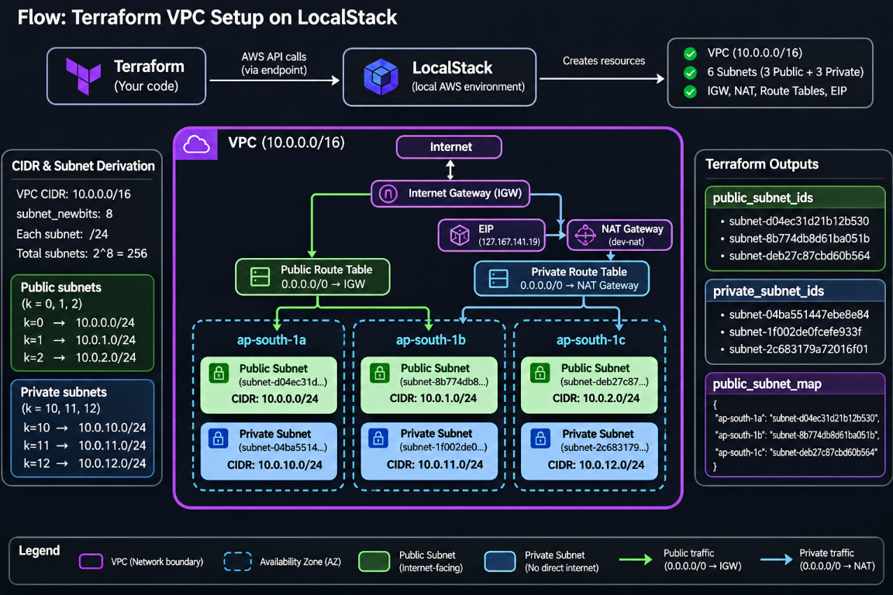

# VPC networking

This example provisions an AWS-style network through LocalStack: one VPC,
public and private subnets in up to three available availability zones, an
internet gateway, one NAT gateway, and public/private route tables. The private
subnets use the NAT gateway for their default route; public subnets use the
internet gateway.

## Architecture



## Files

- `c1-versions.tf` — Terraform/provider requirements and AWS provider settings.
  The provider targets the EC2 API at `http://localhost:4566`.
- `c2-variables.tf` — region, environment name, VPC CIDR, tags, and subnet
  sizing inputs.
- `c3-datasources-and-locals.tf` — discovers available zones and calculates
  subnet CIDRs.
- `c4-vpc.tf` — VPC, gateways, subnets, route tables, and associations.
- `c5-output.tf` — VPC and subnet outputs.

## Requirements

- Terraform 1.0 or later
- LocalStack running and exposing its EC2 API at `http://localhost:4566`

The provider uses placeholder credentials and LocalStack-specific settings.
Support for individual networking resources, especially NAT gateways, depends
on the LocalStack version and edition. Check that your LocalStack setup supports
the resources in this example before applying. Do not use this configuration
against AWS without changing the provider configuration and supplying
appropriate credentials.

## Run

From this directory:

```sh
terraform init
terraform validate
terraform plan
terraform apply
```

The outputs include the VPC ID, public and private subnet IDs, and a map of
availability zones to public subnet IDs. To remove the resources managed by
this example:

```sh
terraform destroy
```

Terraform state and saved plans are local artifacts; do not commit them.
